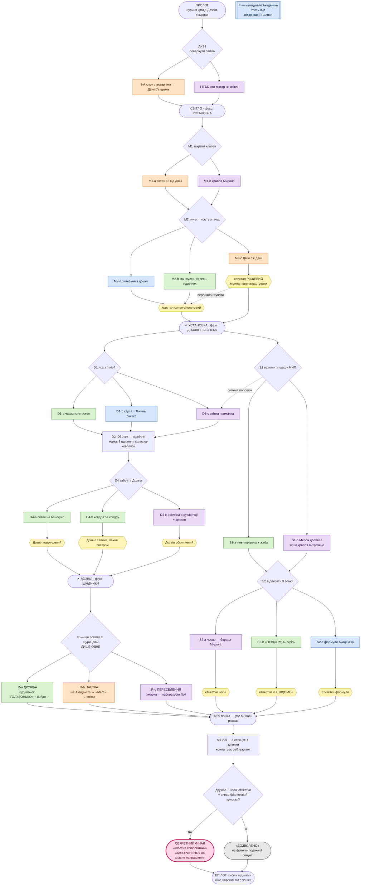

# Схема варіацій — «Перед інспекцією» (v2)

Коди вузлів = коди в `scenario.md`. Колір шляху = чий це метод:
🟢 Ліна (спостереження, людяність) · 🔵 Академік (теорія, потрібен F) · 🟠 Двічі (сила, конструкції) ·
🟣 Мирон (дивна хімія, «одна крапля»). Жовті ромби — стани, що впливають на фінал.
Картинка цієї схеми: `scenario-graph.png`.

## Матриця фіналу (з чого складається фінальна сцена)
| Зупинка | Від чого залежить | Варіанти |
|---|---|---|
| 1. Установка | M2 | синьо-фіолетовий · рожевий |
| 2. Шафа | S2 | чесно · «НЕВІДОМО» · формули |
| 3. Шкідники | R | дружба · пастка · переселення |
| 4. Дозвіл | D4 | надкушений · теплий · обслинений |
| Мікро | I-B | борода Мирона світиться / ні |
| Печатка | R-a + S2-a + синій | секретний фінал / звичайний |

2 × 3 × 3 × 3 = **54 комбінації** фінальної сцени з **~11 коротких анімацій-варіантів** (модульний фінал).
